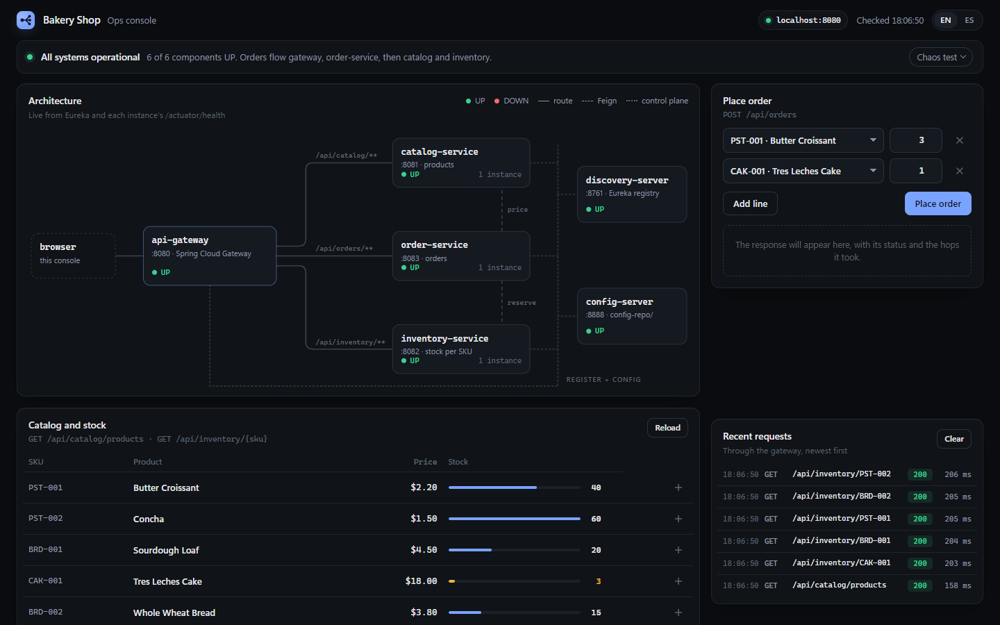
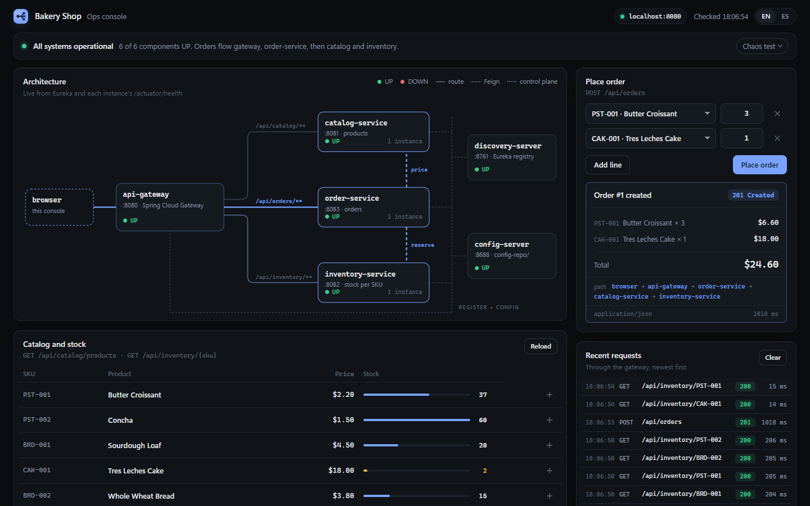
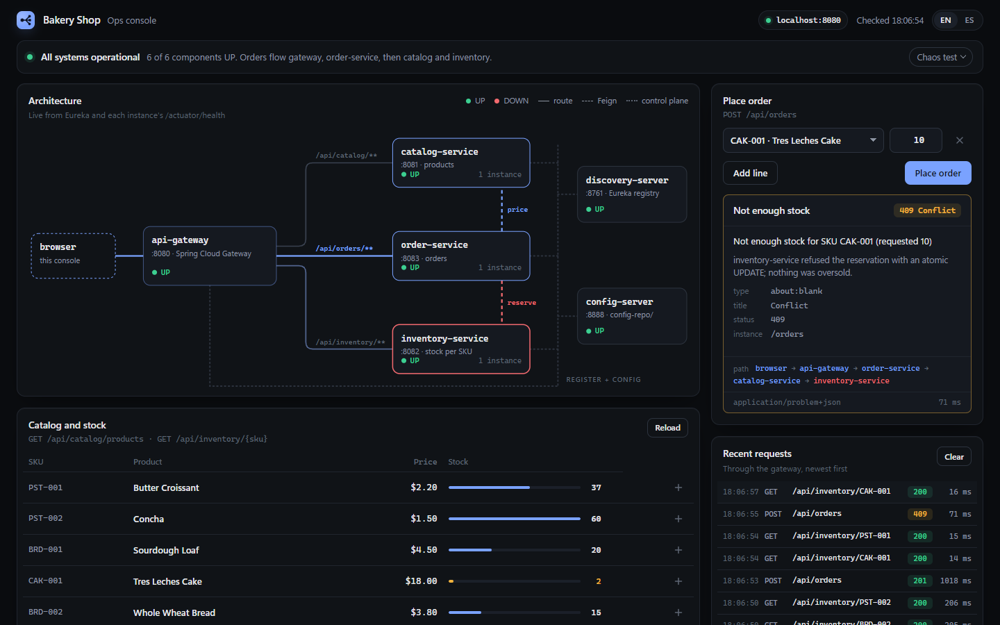
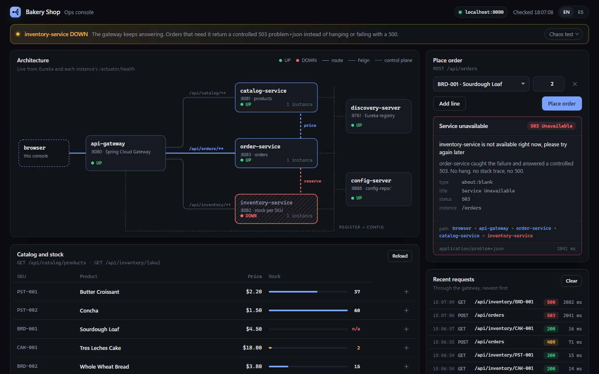
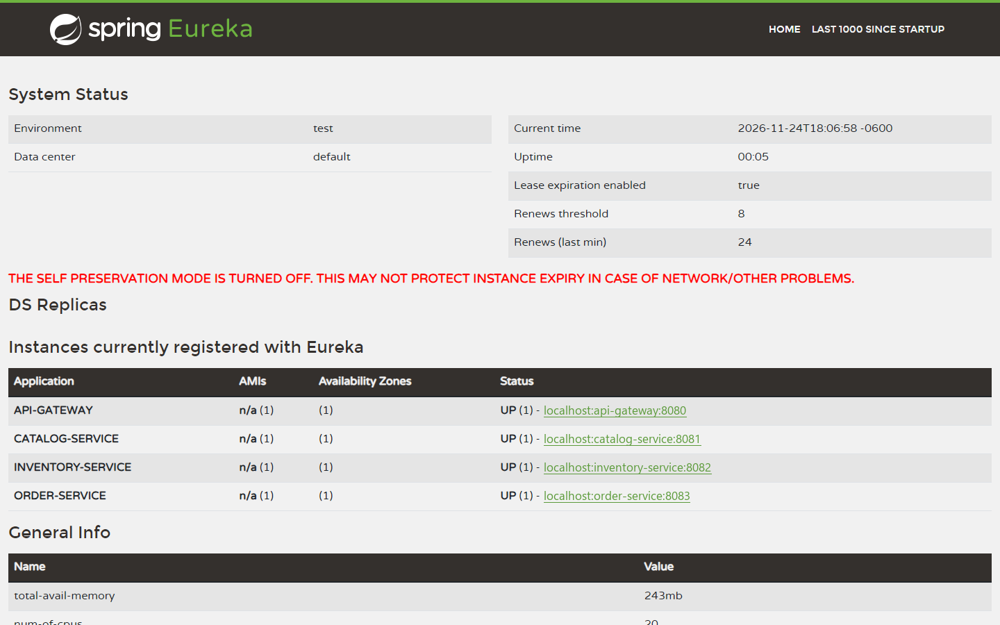
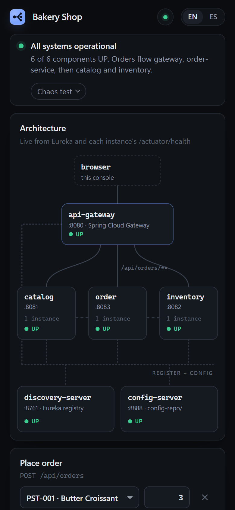

# Bakery Shop · Spring Cloud Microservices

A small bakery shop split into **three independent Java services** that talk to each other over REST,
behind an **API Gateway**, with **Eureka service discovery** and a **centralized Config Server**.
Each service owns its own database, no service has another service's URL hardcoded, configuration
is separated by environment, and everything can run with Docker Compose.

Author: **Jovany Morales del Ángel** · MIT License

---

## Architecture

```
                         ┌───────────────────────┐
   HTTP client ────────► │   api-gateway  :8080  │   /api/catalog/**   → lb://catalog-service
  (curl, browser)        │  Spring Cloud Gateway │   /api/inventory/** → lb://inventory-service
                         └───────────┬───────────┘   /api/orders/**    → lb://order-service
                                     │  (routes by service name, resolved through Eureka)
        ┌────────────────────────────┼────────────────────────────┐
        ▼                            ▼                            ▼
┌──────────────────┐        ┌──────────────────┐        ┌──────────────────┐
│ catalog-service  │        │ inventory-service│        │  order-service   │
│ :8081 products   │        │ :8082 stock/SKU  │        │  :8083 orders    │
│ (H2 catalogdb)   │        │ (H2 inventorydb) │        │  (H2 orderdb)    │
└──────────────────┘        └──────────────────┘        └────────┬─────────┘
        ▲                            ▲                           │
        │   GET /products/sku/{sku}  │ POST /inventory/{sku}/reserve
        └────────────────────────────┴───────────────────────────┘
                       OpenFeign, by service name (no URLs)

  On startup every service:  1) loads its config from     2) registers in / reads from
                             ┌───────────────────────┐    ┌─────────────────────────┐
                             │ config-server  :8888  │    │ discovery-server  :8761 │
                             │ reads ./config-repo   │    │ Eureka registry         │
                             └───────────────────────┘    └─────────────────────────┘
```

| Module | Port | What it does |
|---|---|---|
| `config-server` | 8888 | Spring Cloud Config Server (`native` profile) serving the yml files in `config-repo/` |
| `discovery-server` | 8761 | Eureka server; dashboard at http://localhost:8761 |
| `api-gateway` | 8080 | Spring Cloud Gateway; the only port clients need. Also serves the ops console at `/` |
| `catalog-service` | 8081 | Products: id, sku, name, price |
| `inventory-service` | 8082 | Stock per SKU; reserves units atomically |
| `order-service` | 8083 | Creates orders using catalog (prices) and inventory (stock) |

**Versions:** Java 17 · Spring Boot 3.5.13 · Spring Cloud 2025.0.3 · Maven (wrapper included).

```
spring-cloud-microservices/
├── pom.xml                 parent pom (Boot parent + Spring Cloud BOM)
├── config-repo/            configuration served by config-server
│   ├── application.yml            shared by all services (local)
│   ├── application-docker.yml     shared overrides for Docker
│   ├── application-mysql.yml      optional MySQL profile (env vars only)
│   └── <service>.yml / <service>-docker.yml
├── config-server/
├── discovery-server/
├── api-gateway/
├── catalog-service/
├── inventory-service/
├── order-service/
├── Dockerfile              one multi-stage Dockerfile for every module (build arg MODULE)
└── docker-compose.yml
```

## Endpoints (through the gateway)

| Method | URL | Description |
|---|---|---|
| GET | `/api/catalog/products` | List products |
| GET | `/api/catalog/products/{id}` | Product by id |
| GET | `/api/catalog/products/sku/{sku}` | Product by SKU |
| GET | `/api/inventory/{sku}` | Stock of a product |
| POST | `/api/inventory/{sku}/reserve` | Body `{"quantity": 2}` → 200, or **409** if not enough stock |
| POST | `/api/orders` | Body `{"items":[{"sku":"PST-001","quantity":3}]}` → **201** |
| GET | `/api/orders/{id}` | Order with its lines and total |
| GET | `/console/api/status` | Read-only status for the ops console (Eureka instances + their health) |

Errors use the standard `application/problem+json` format:

| Situation | Status |
|---|---|
| Unknown product SKU in an order | 404 |
| Not enough stock | 409 |
| Invalid body (empty items, quantity < 1) | 400 |
| catalog-service or inventory-service down / timing out | **503** |

Seed data (fictional): `BRD-001` Sourdough Loaf, `BRD-002` Whole Wheat Bread, `PST-001` Butter Croissant,
`PST-002` Concha, `CAK-001` Tres Leches Cake (only 3 in stock, handy to test the 409).

## How to run

### Option A — local jars (no Docker)

Requires JDK 17+.

```bash
./mvnw -B package -DskipTests          # Windows: mvnw.cmd -B package -DskipTests
```

Start each one in its own terminal **from the repository root** (the config server reads `./config-repo`),
in this order: config-server and discovery-server first, then the services, then the gateway.

```bash
java -Xmx256m -jar config-server/target/config-server.jar
java -Xmx256m -jar discovery-server/target/discovery-server.jar
java -Xmx256m -jar catalog-service/target/catalog-service.jar
java -Xmx256m -jar inventory-service/target/inventory-service.jar
java -Xmx256m -jar order-service/target/order-service.jar
java -Xmx256m -jar api-gateway/target/api-gateway.jar
```

Wait ~20 seconds until all services show as UP in http://localhost:8761, then:

```bash
curl http://localhost:8080/api/catalog/products
curl http://localhost:8080/api/inventory/CAK-001
curl -X POST http://localhost:8080/api/orders -H "Content-Type: application/json" \
     -d '{"items":[{"sku":"PST-001","quantity":3},{"sku":"CAK-001","quantity":1}]}'
curl http://localhost:8080/api/orders/1
```

Example results:

```
POST /api/orders                       → 201 {"id":1,"items":[...],"total":24.60,...}
POST /api/orders (CAK-001 x10)         → 409 {"detail":"Not enough stock for SKU CAK-001 (requested 10)"}
POST /api/orders (inventory stopped)   → 503 {"detail":"inventory-service is not available right now, please try again later"}
```

### Option B — Docker Compose

```bash
docker compose up --build
```

All containers use the `docker` profile. Compose waits for each `/actuator/health` before starting the
next layer (config-server → discovery-server → services → gateway). Only the gateway (8080), Eureka (8761)
and the config server (8888) are published; the business services are reachable only through the gateway.

### Optional: MySQL instead of H2

Every business service has a `mysql` profile whose values come **only from environment variables**
(`config-repo/application-mysql.yml`), so no password is ever written in a file. Each service gets its own database:

```bash
SPRING_PROFILES_ACTIVE=mysql \
DB_URL=jdbc:mysql://localhost:3306/catalog_db DB_USERNAME=bakery DB_PASSWORD=*** \
java -jar catalog-service/target/catalog-service.jar
```

## Ops console

The gateway also serves a small **ops console** at **http://localhost:8080/** (static HTML, CSS and plain
JavaScript in `api-gateway/src/main/resources/static/`, no build step and no external fonts or CDNs).
Start the system with Option A or B above, wait until everything is registered, and open that URL.

- **Architecture map**: gateway, the three services, Eureka and the Config Server, each with its live status.
  The status comes from `GET /console/api/status`, a read-only gateway endpoint that asks the
  `DiscoveryClient` which instances are registered and calls `/actuator/health` on each one
  (plus Eureka and the Config Server). The health call decides UP or DOWN, so a dead process is
  shown as DOWN even while Eureka still lists it.
- **Catalog and stock**: `GET /api/catalog/products` and `GET /api/inventory/{sku}` per product.
- **Place order**: builds `POST /api/orders`, shows the 201 order or the `problem+json` error (404, 409, 503)
  as a card, and animates the hops on the map (gateway, order-service, catalog, inventory). The failing hop is drawn in red.
- **Chaos test**: stop inventory-service and the banner turns amber within seconds; orders then get a
  controlled **503** instead of hanging.
- **Recent requests** with status and latency, and an **EN / ES** toggle.

| | |
|---|---|
|  |  |
| All services UP, products and live stock | `201 Created`, request path highlighted on the map |
|  |  |
| `409 Conflict`: CAK-001 x10, the inventory hop fails | inventory-service stopped: amber banner, controlled `503` |
|  |  |
| The real Eureka dashboard with every service registered | Phone layout (390 x 844) |

```bash
curl http://localhost:8080/console/api/status   # {"overall":"UP","infrastructure":[...],"services":[...]}
```

## Design decisions

**Why service discovery (Eureka)?**
Services never know each other's host or port. order-service calls `catalog-service` and
`inventory-service` by *name* (`@FeignClient(name = "inventory-service")`) and the gateway routes to
`lb://order-service`. Eureka keeps the list of live instances and Spring Cloud LoadBalancer picks one.
If a service moves to another port or we start two copies, nothing else has to change.

**Why a Config Server?**
All configuration lives in one folder (`config-repo/`) instead of being spread across six `application.yml` files.
Each service only knows its name and where the config server is
(`spring.config.import=optional:configserver:${CONFIG_SERVER_URL:http://localhost:8888}`).
Environments are separated with Spring profiles: `catalog-service.yml` is the local default and
`catalog-service-docker.yml` / `application-docker.yml` override what changes inside Docker
(e.g. Eureka is `discovery-server:8761` instead of `localhost:8761`).

**Database per service.**
Each business service has its own H2 database (`catalogdb`, `inventorydb`, `orderdb`).
Services share data only through their REST APIs; the SKU is the only "foreign key" between them.
The order stores a copy of the product name and price, so a later price change does not alter old orders.

**How failures are handled.**
- order-service first asks the catalog for every price, so an unknown SKU fails (404) *before* any stock is reserved.
- inventory-service reserves stock with a single atomic `UPDATE ... WHERE quantity >= :quantity`,
  so two simultaneous orders cannot sell the same last cake. Not enough stock → 409.
- Calls to other services have short timeouts (2 s connect / 3 s read, in `config-repo/order-service.yml`).
  Any network error, timeout, missing instance or 5xx from a dependency is translated into a clear
  **503 Service Unavailable** instead of a generic 500 or a hanging request.

**Known limitations (next steps).**
- If an order has several items and the second reservation fails, the first one is not released.
  A real system would add a "release stock" endpoint and compensate (Saga pattern), or use events.
- A circuit breaker (Resilience4j) could stop calling a service that is already known to be down.
- If you call `/api/inventory/**` directly while inventory-service is down, the gateway itself answers with its default error (500).

## Tests

```bash
./mvnw -B verify          # Windows: mvnw.cmd -B verify
```

49 JUnit 5 tests, no external services needed (Config Server and Eureka are disabled in tests):

- **order-service** – business logic with mocked Feign clients (success, total computation, 409, unknown SKU, catalog/inventory down → 503),
  MockMvc controller tests and a full-context test with H2.
- **inventory-service** – controller tests and service tests against H2 (atomic reservation, insufficient stock).
- **catalog-service** – controller tests and seed-data test.
- **api-gateway** – the three routes load from configuration and point to `lb://` service ids; the console
  status endpoint with a mocked `DiscoveryClient` and health probe (all UP, instance DOWN while still registered,
  no instance registered, one healthy instance out of two, infrastructure DOWN, registry error) via `WebTestClient`;
  and the full context serving the page at `/` and the status endpoint without Eureka.
- **config-server** – serves `catalog-service/default` and the Docker overrides from `config-repo/`.
- **discovery-server** – Eureka starts and is healthy.

CI runs the same command on every push (`.github/workflows/ci.yml`, Temurin 17).
